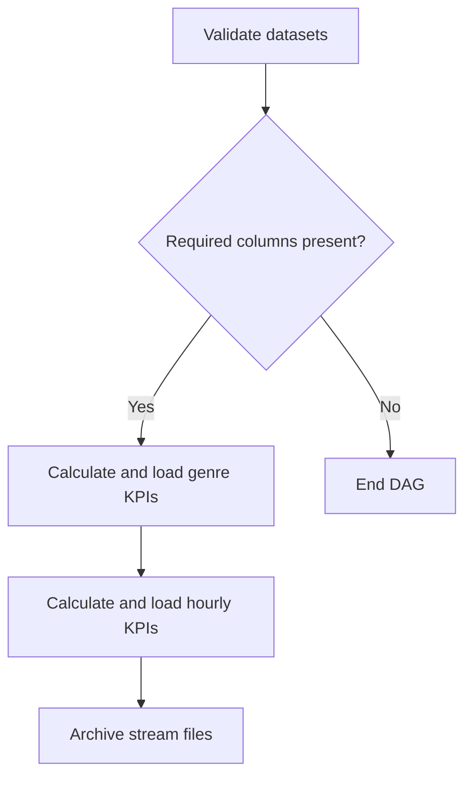

# Spotify Batch Ingestion and Airflow Orchestration

An Apache Airflow pipeline that reads Spotify-style CSV datasets from Amazon S3, validates required columns, calculates listening KPIs with pandas, and loads reporting tables into Amazon Redshift.

This README describes the supplied DAG. Infrastructure definitions, sample datasets, database DDL, and a tested dependency lockfile were not included. The setup below identifies what must be supplied before running it.

## Architecture

| Component | Role |
| --- | --- |
| Amazon S3 | Stores songs, users, incoming stream files, and archived files |
| Apache Airflow | Schedules tasks, branches on validation results, retries failures, and records logs |
| pandas | Joins datasets and computes genre and hourly aggregates inside Airflow workers |
| boto3 | Lists, reads, copies, and deletes S3 objects |
| Amazon Redshift | Stores reporting results and staging tables |
| PostgresHook | Opens the database connection identified by `redshift_default` |

Airflow workers read CSV data from S3 and send aggregate rows directly to Redshift using SQL inserts. This implementation does **not** use Redshift `COPY`, EMR, or Spark. It can be hosted on a compatible self-managed Airflow installation or adapted for MWAA; deployment infrastructure is outside the supplied code.

## Airflow workflow

DAG ID: `data_validation_and_kpi_computation`



| Task ID | Behavior |
| --- | --- |
| `validate_datasets` | Reads songs, users, and listed stream CSVs; checks required column names; returns results through XCom |
| `check_validation` | Selects the genre task when all returned validation flags are true; otherwise selects `end_dag` |
| `calculate_genre_level_kpis` | Reads streams and songs, calculates daily genre metrics, and loads Redshift |
| `calculate_hourly_kpis` | Reads streams, songs, and users, calculates hourly metrics, and loads Redshift |
| `move_processed_files` | Copies listed stream objects to an archive key, then deletes their original keys |
| `end_dag` | No-op endpoint for the invalid-schema branch |

The KPI tasks run sequentially. Each loads its own output before the next task begins. Archiving runs only after both KPI tasks succeed.

### Scheduling and failures

- Schedule: `@daily`.
- Start date: dynamically set using `days_ago(1)`.
- Each task has one retry after five minutes.
- Tasks do not depend on the previous run's task state.
- Failure and retry emails are disabled.
- `catchup` and maximum concurrent DAG runs are not explicitly configured.
- Missing columns lead to the end branch, rather than explicitly failing validation. Read/API exceptions are raised and fail the task.

The DAG does not filter input by its Airflow data interval: each run reads every CSV returned under the stream prefix.

## Source data

Default bucket: `nl-aws-de-labs`. Change `BUCKET_NAME` to your own bucket before deployment.

| Dataset | S3 key or prefix | Required columns |
| --- | --- | --- |
| Songs | `spotify-prefix/songs.csv` | `id`, `track_id`, `artists`, `album_name`, `track_name`, `popularity`, `duration_ms`, `explicit`, `danceability`, `energy`, `key`, `loudness`, `mode`, `speechiness`, `acousticness`, `instrumentalness`, `liveness`, `valence`, `tempo`, `time_signature`, `track_genre` |
| Users | `spotify-prefix/users.csv` | `user_id`, `user_name`, `user_age`, `user_country`, `created_at` |
| Streams | `spotify-prefix/streams/` | `user_id`, `track_id`, `listen_time` |
| Archive | `spotify-prefix/streams/archived/` | Processed stream CSVs |

Only keys ending in `.csv` are selected. Column validation allows extra columns and does not check nulls, uniqueness, types, timestamp validity, or foreign-key integrity.

## Reporting outputs

### Daily genre metrics

Target: `reporting_schema.genre_level_kpis`  
Staging table: `reporting_schema.tmp_genre_level_kpis`  
Replacement key: `listen_date`, `track_genre`

| Column | Meaning |
| --- | --- |
| `listen_date` | Date extracted from `listen_time` |
| `track_genre` | Genre joined from songs using `track_id` |
| `listen_count` | Number of joined stream rows for that date and genre |
| `popularity_index` | Genre listen count divided by total joined stream rows for the date |
| `average_duration` | Average song length in seconds across joined stream rows |
| `most_popular_track_id` | Track with the highest stream count within the date and genre |

`average_duration` measures song length, not how long someone actually listened. Streams are left-joined to songs; unmatched songs can contribute to the daily denominator while being excluded from genre groups with null genre values. Duplicate song keys can multiply stream rows.

### Hourly metrics

Target: `reporting_schema.hourly_kpis`  
Staging table: `reporting_schema.tmp_hourly_kpis`  
Replacement key: `listen_date`, `listen_hour`

| Column | Meaning |
| --- | --- |
| `listen_date` | Date extracted from the timestamp |
| `listen_hour` | Hour extracted from the timestamp |
| `unique_listeners` | Distinct users within the hour |
| `listen_counts` | Number of streams attributed to the selected top artist, not total hourly streams |
| `top_artist` | Artist field with the highest stream count in the hour |
| `avg_sessions_per_user` | Average count of distinct user-and-timestamp identifiers per user in the hour |
| `diversity_index` | Distinct tracks divided by joined stream rows in the hour |
| `most_engaged_age_group` | Age group with the highest stream count in the hour |

Hourly calculations use inner joins, so streams without matching users or songs are excluded. The session identifier is a timestamp-based proxy; it does not implement inactivity-based session boundaries. The `artists` field is grouped as supplied and is not split into individual artists. The first age bin is labelled `18-25` but actually includes ages greater than 0 through 25. Timezone normalization and explicit tie-breaking rules are not implemented.

## Redshift loading

For each output DataFrame, `upsert_to_redshift`:

1. Inserts rows into the corresponding staging table using `executemany`.
2. Deletes target rows matching staging keys.
3. Inserts all staging rows into the target using `SELECT *`.
4. Truncates the staging table.

Both target and staging tables must already exist. The target column order must match the staging column order because the final insert uses `SELECT *`. Prefer matching both to the output column orders shown above.

This is a delete-and-insert replacement approach, not a SQL `MERGE`. It replaces only keys present in the current output; it does not combine partial aggregates with historical values. Shared staging tables and the transaction block require review before concurrent or production use. In particular, Redshift `TRUNCATE` has transaction implications; do not assume the entire routine is fully rollback-safe.

## Setup

### 1. Prepare the Airflow environment

Provide a working Airflow installation with pandas, boto3, the PostgreSQL provider, and its database driver available to workers. Pin dependencies using constraints appropriate to your chosen Airflow environment.

The supplied code uses legacy imports and arguments, including `airflow.operators.dummy`, `airflow.hooks.postgres_hook`, `days_ago`, `provide_context`, and `schedule_interval`. Check compatibility and update these as needed for your installed Airflow version before deployment. No specific version was verified for this README.

### 2. Configure S3

Create or choose a bucket, update the source constants, and upload `songs.csv`, `users.csv`, and a small stream CSV to the configured locations. Keep reference keys unique: songs by `track_id`, users by `user_id`.

Grant the worker's AWS identity:

- `s3:ListBucket` on the bucket, restricted to relevant prefixes where practical.
- `s3:GetObject` for reference and stream objects.
- `s3:PutObject` for archive destinations.
- `s3:DeleteObject` for processed source objects.
- Applicable KMS permissions if objects use a customer-managed encryption key.

Use an execution/instance role in AWS or another supported credential mechanism for local development. The DAG creates boto3 clients directly and does not specify an Airflow AWS connection ID.

### 3. Prepare Redshift

Create `reporting_schema` and the four tables listed above. Use appropriate date, integer, floating-point/decimal, and text types, with text widths suitable for the actual data. Table DDL was not supplied.

Create an Airflow connection with:

| Field | Value |
| --- | --- |
| Connection ID | `redshift_default` |
| Connection type | PostgreSQL, compatible with the supplied `PostgresHook` |
| Host | Your Redshift endpoint |
| Port | Your configured Redshift port |
| Database / Schema connection field | Your database name |
| Login and password | Database credentials, preferably backed by a secrets manager |
| Extra | SSL configuration appropriate to your environment |

The connection's database field is separate from the SQL schema `reporting_schema`.

Allow worker network access to the Redshift endpoint through routing and security groups. For private Redshift, workers need a private network path. Grant the database user schema access and the insert, delete, select, and staging-table truncate rights required by the routine. Redshift does not need an S3 read role for this direct-insert loading path.

### 4. Deploy and run

Save the supplied Python code as, for example, `spotify_batch_ingestion.py` in the configured Airflow DAG directory. For MWAA, upload it under the environment's configured S3 DAG prefix after resolving version compatibility.

Confirm the DAG imports successfully, inspect the task graph, and trigger a manual run with a small batch. Resolve the limitations below before enabling routine scheduled execution.

## Verify the results

Run these queries in Redshift after the KPI tasks succeed:

```sql
SELECT *
FROM reporting_schema.genre_level_kpis
ORDER BY listen_date DESC, track_genre
LIMIT 20;

SELECT *
FROM reporting_schema.hourly_kpis
ORDER BY listen_date DESC, listen_hour DESC
LIMIT 24;

-- These queries should return no duplicate reporting keys.
SELECT listen_date, track_genre, COUNT(*)
FROM reporting_schema.genre_level_kpis
GROUP BY listen_date, track_genre
HAVING COUNT(*) > 1;

SELECT listen_date, listen_hour, COUNT(*)
FROM reporting_schema.hourly_kpis
GROUP BY listen_date, listen_hour
HAVING COUNT(*) > 1;
```

Check task logs for validation results and load outcomes. Confirm source files are archived only after successful KPI loads. Reconcile a small batch manually to verify counts and joins; successful task status alone does not establish metric correctness.

## Known limitations and recommended improvements

The following are observations from the supplied code, not implemented fixes:

| Issue | Impact and recommended change |
| --- | --- |
| Archive is nested under input prefix | S3 listing includes archived CSVs. Reprocessing can create nested `archived/archived/` keys. Exclude archive keys or use a separate input prefix. |
| Single unpaginated S3 list call | Later objects can be missed. Use a paginator. |
| No empty-batch handling | With no stream files, the stream validation flag is absent and branching can still proceed; `pd.concat([])` then fails. Explicitly skip or fail empty batches. |
| Input is listed independently by several tasks | Files arriving between tasks can yield inconsistent KPIs or be archived without processing. Capture one immutable batch manifest and pass it to every task. |
| No interval or partition filter | Runs aggregate every listed file, regardless of schedule date. Select an explicit batch or interval. |
| Partial aggregates overwrite existing keys | A later batch for the same date/hour can replace earlier totals. Recompute complete affected partitions or implement correct incremental aggregation. |
| Shared staging tables | Overlapping runs can interfere. Serialize runs and use isolated staging tables or run identifiers. |
| No full-run transaction | Genre output can commit before the hourly task fails. Define recovery and publication behavior. |
| Copy and delete are separate S3 operations | Archiving can partially complete. Track per-file progress and make retries safe. |
| Entire batch held in worker RAM | Input size is bounded by worker memory. Use bounded/chunked processing or external compute for larger datasets. |
| Session calculation is unclear | `.nunique('session_id')` passes a positional argument rather than selecting the column. Use explicit column selection before counting, and define real session rules if needed. |
| Validation is limited to column presence | Add type, null, timestamp, uniqueness, and join-integrity checks. Make invalid-data outcomes explicit. |
| No pinned runtime or dependency files | Add tested dependency constraints, deployment instructions, and meaningful fixture-based checks. |

## Troubleshooting

| Symptom | What to inspect |
| --- | --- |
| DAG does not appear | DAG import errors, legacy APIs, missing providers or dependencies |
| S3 access denied | Worker credentials, bucket policy, object permissions, KMS permissions |
| Redshift connection timeout | Endpoint, port, routing, security groups, private network access |
| Relation does not exist | Database name, `reporting_schema`, target and staging table creation |
| Empty-concatenation error | Whether the stream prefix contains input CSVs |
| Unexpected or inflated metrics | Archived inputs, duplicate reference keys, unmatched joins, timestamp handling |
| Repeated archive folders | Archive keys being included in the input listing |

## Project scope

This project demonstrates batch ingestion, schema checks, Airflow branching, pandas transformations, direct Redshift loading, and S3 archival. The supplied code was reviewed for documentation; it was not executed against AWS, and no successful deployment or production-readiness claim is implied.
